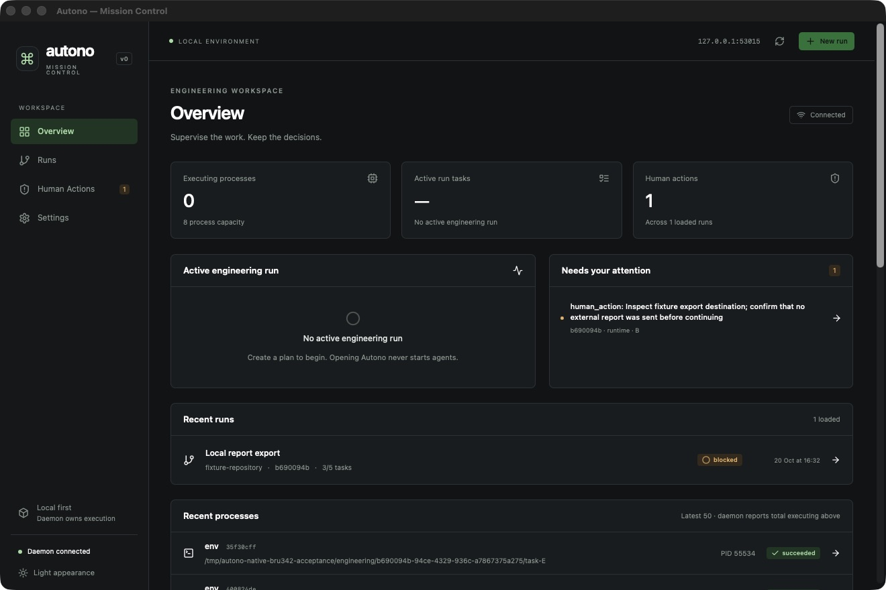
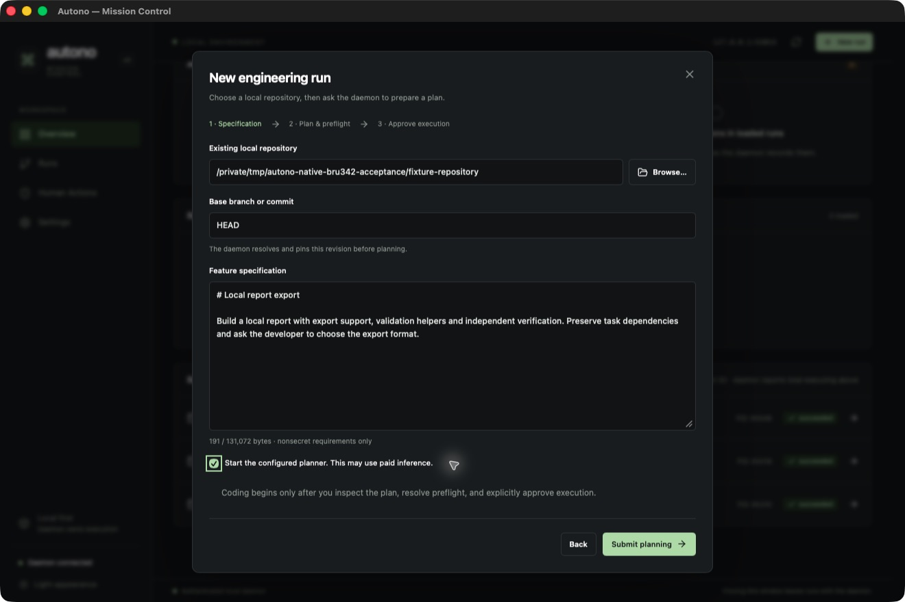
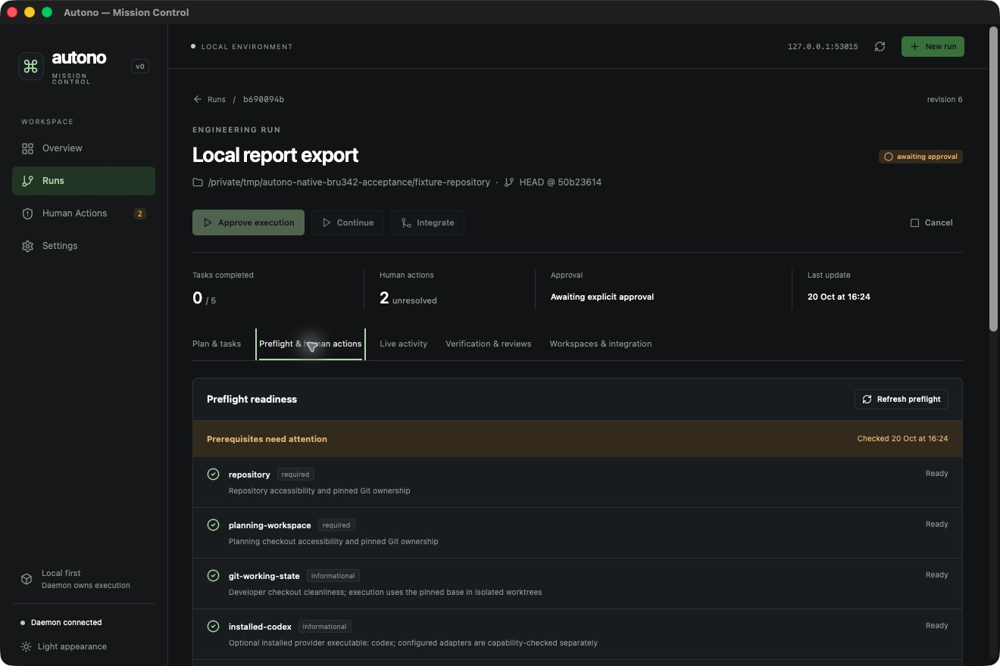
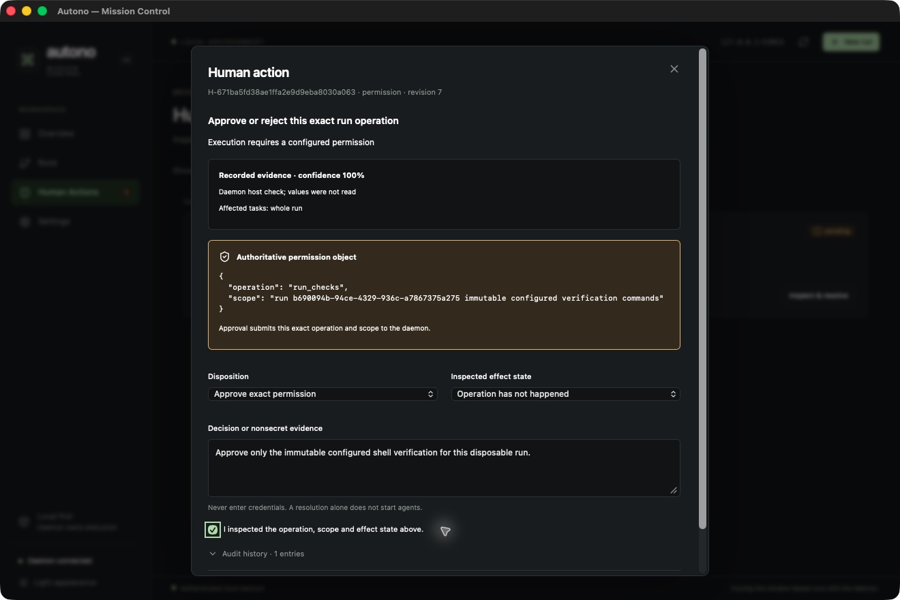
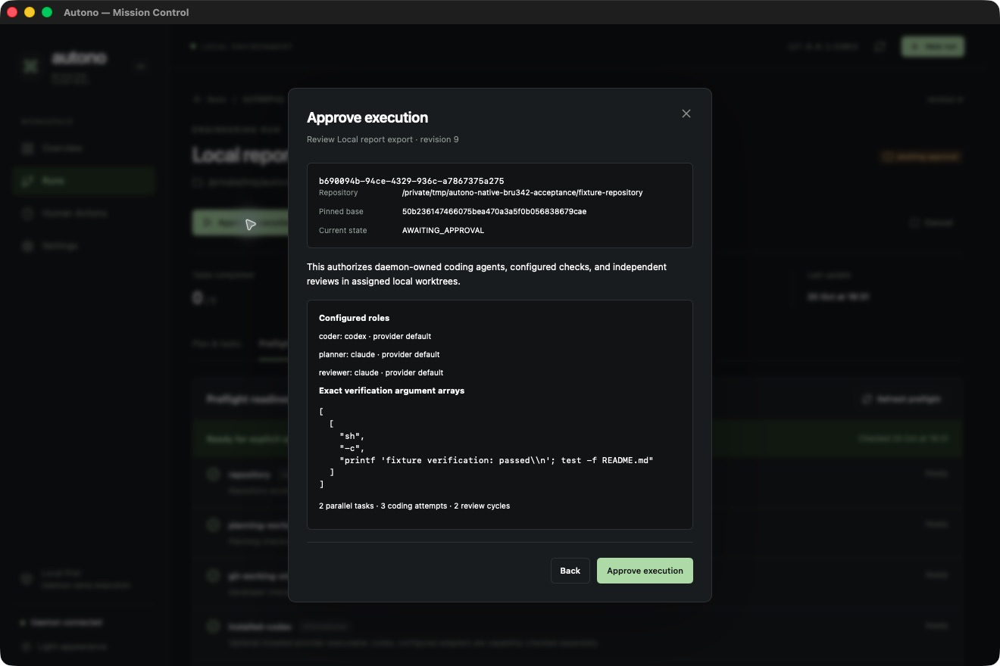
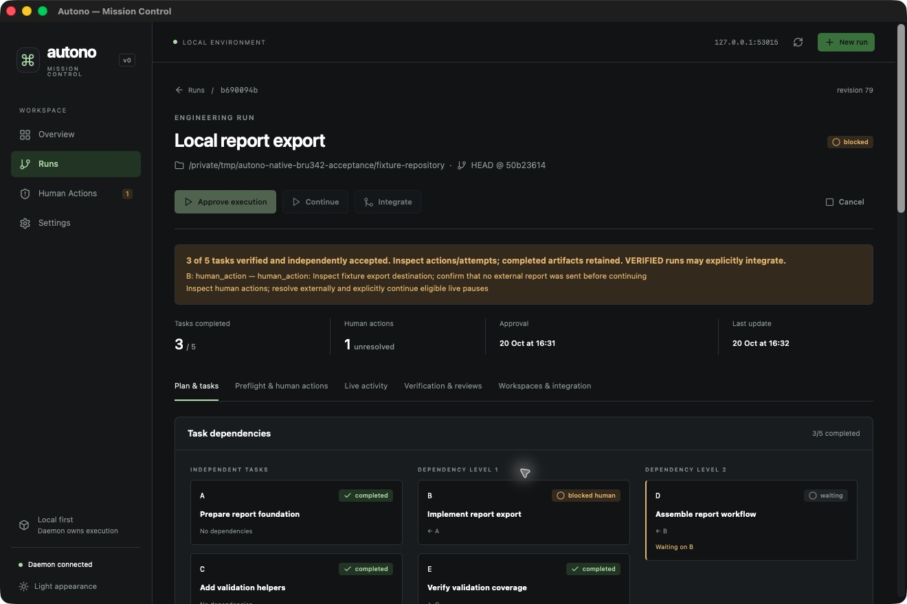
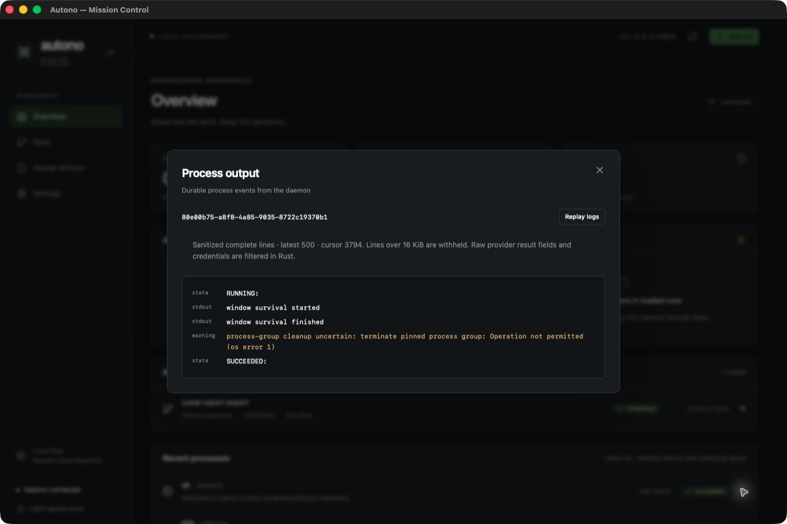
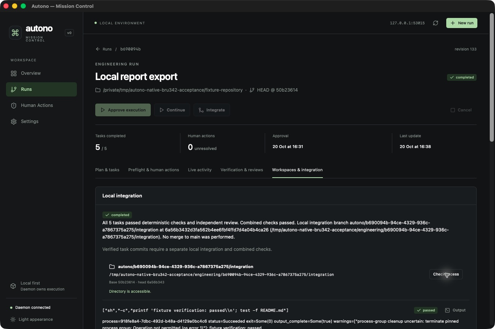
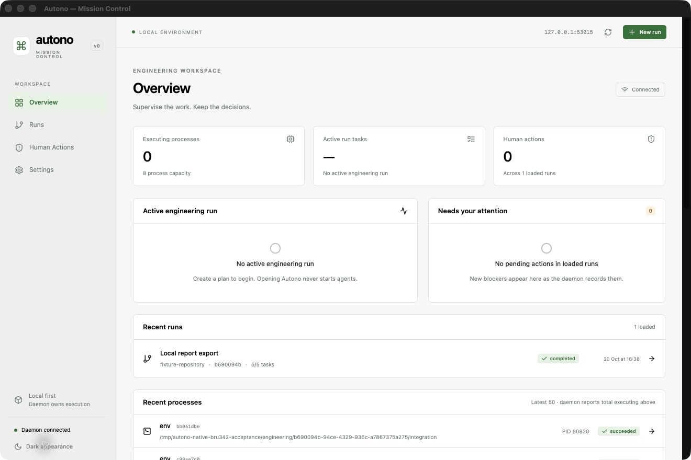
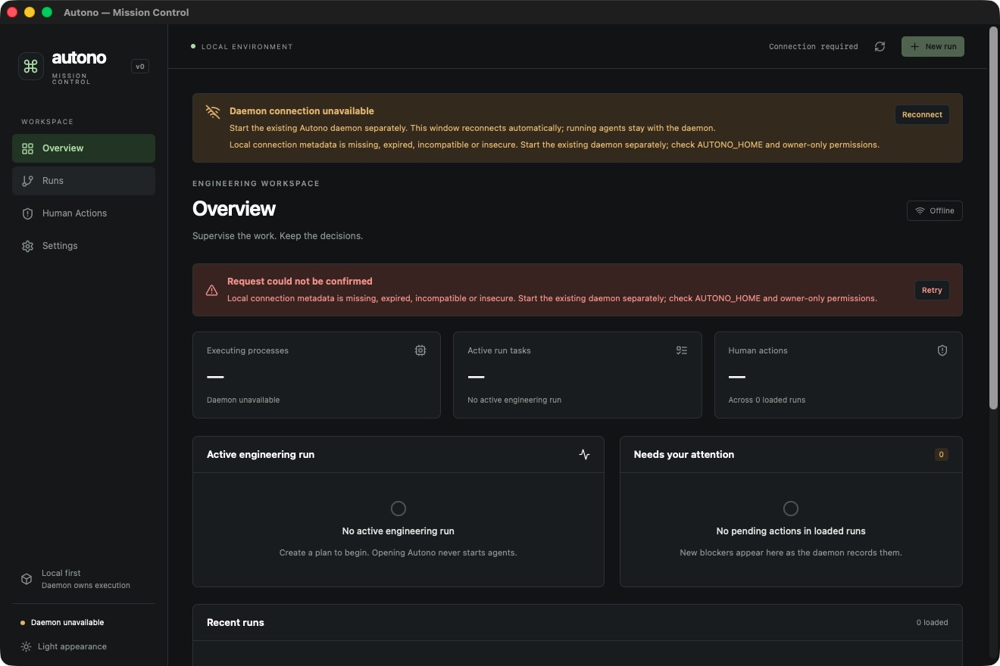

# Native Mission Control v0 — BRU-342 acceptance

Implemented on `feat/bru-342-native-mission-control` from verified main
`11c5ddde583acbe400f444386a0bf6b24ea22364`. GitHub reports PR #3 merged on
2026-10-20 at 19:37:45 UTC. Main includes M3 preflight, human escalation,
resolution receipts, effect reconciliation and the review-regression repairs in
`dec0ed9`. The working tree was clean before the feature branch was created.
No daemon, protocol, migration or orchestration implementation was replaced.

## Architecture and implemented scope

`apps/desktop/src` contains React/TypeScript, Vite, Tailwind, Radix/shadcn-style
components, TanStack Query and Lucide. `apps/desktop/src-tauri` is a member of the
existing Rust workspace. A fixed Rust request enum bridges the existing authenticated
loopback API; no daemon bearer token or credential file crosses into JavaScript.
The desktop does not launch the daemon, coding agents, shell commands or installers.
The daemon retains planning, task scheduling, permissions, verification, reviews,
cancellation, continuation, durable events and integration authority.

Overview, paged runs, human actions and settings are implemented. Run details include
original specification, requirements, milestones, labelled dependency layers,
blocked ancestors, task/attempt states, agent/process references, deterministic
verification, complete structured review attempts/findings, tree/commit evidence,
owned workspace paths and local integration. Events and sanitized process output
poll with durable cursors and bounded pages/retention. The native folder picker,
explicit planner acknowledgement, immutable plan/preflight inspection, exact
permission objects, inspected effects, resolution audit history and separate
execution/continuation/integration confirmations are functional. Rejected/stale
requests display errors; successful admission is distinguished from completion.

Settings inspect user-file defaults, live daemon health/power, filesystem-only CLI
availability, role configuration, execution bounds, verification and stay-awake.
Effective project overrides remain immutable run settings. Configuration editing
and arbitrary artifact-content access are intentionally not exposed.

## Real native macOS acceptance

The screenshots below are actual Tauri WKWebView windows, not browser mockups.
The native app connected to a disposable local daemon built from the existing
`autono-daemon::api::workflow_router`, Runtime supervisor, SQLite, real Git and the
existing engineering service. Only `AgentRuntime` is injected with shell-only
fixture providers. No installed Codex/Claude CLI or paid inference API was invoked.
The reproducible fixture is `apps/desktop/src-tauri/examples/disposable_daemon.rs`.

The test daemon used `127.0.0.1:53015`, PID `33398`, API v1 and the owner-only home
`/tmp/autono-native-bru342-acceptance`. The native UI selected its existing fixture
repository with the macOS directory chooser and submitted planning. Run
`b690094b-94ce-4329-936c-a7867375a275` progressed through planning, awaiting approval,
running, blocked, verified, integrating and completed. The UI submitted product and
exact `run_checks` permission resolutions, refreshed preflight, approved execution,
resolved the runtime checkpoint with `not_performed`, explicitly continued, and
integrated. These mutations are present in the daemon's durable audit/event state.

The graph A → B → D and C → E reached A/C/E completed, B `BLOCKED_HUMAN`, D `WAITING`.
The native graph correctly labelled D as waiting on B. Resolving B alone did not
start execution; explicit continuation completed B and D. A/C/E retained one attempt
each, B used two, and D used one. All final verified/preserved tree pairs match.
Independent reviews in this acceptance are deterministic fixture reviews, not a
claim of a new independent review of Autono's implementation.

The run finished at revision 133 with all five tasks completed. Combined checks
passed and the daemon preserved integration commit
`6a56b3432d3fa562b4ee6fbf4ffd7d4a04b4ca26` on its own
`autono/b690094b-94ce-4329-936c-a7867375a275/integration` branch. The fixture's main
remained at pinned base `50b236147466075bea470a3a5f0b056838679cae`. The UI verified
that the associated integration directory was accessible. No push or merge occurred.

The engineering journal contained 155 durable events, ending at cursor 155. The
native output viewer rendered `fixture verification: passed`; it also replayed the
window-survival process through RUNNING/output/SUCCEEDED with cursor 3794. Standard
warnings were preserved after redaction, rather than being silently hidden.

For the window-lifetime check, the fixture daemon accepted a harmless 45-second
shell process `80e00b75-a8f8-4a85-9035-8722c19370b1`. Closing the native window left
**no desktop process**, while daemon PID 33398 remained healthy and the owned process
PID 52352 was still **RUNNING**. It later **SUCCEEDED** with complete output. The
reopened native app displayed that result. This exercises the same daemon process
ownership used by the injected agents without paid provider execution.

Light/dark appearance, disconnected metadata handling, reconnection, real status
updates, readiness, resolutions, logs, workspace access and integration were
inspected in the native window. Native automation had intermittent accessibility
`elementHasNoFrame`/timeout errors; refreshed state and visible controls were used,
and daemon state was checked independently. Bounded background polling was enabled
so status continues updating when macOS backgrounds the window.

Machine-readable, nonsecret observations: [acceptance evidence](desktop-acceptance-evidence.json).

## Native screenshots

| Screen | Evidence |
| --- | --- |
| Overview |  |
| New run |  |
| Preflight |  |
| Permission |  |
| Execution approval |  |
| Blocked graph |  |
| Process logs |  |
| Integration |  |
| Light settings |  |
| Disconnection |  |

## Validation

- `cargo fmt --check`: passed.
- `cargo clippy --workspace --all-targets -- -D warnings`: passed.
- `cargo test --workspace -- --test-threads=2`: **92 passed**, **2 ignored**.
  The ignored tests are paid real-agent acceptance and an isolated subprocess
  helper exercised through its deterministic parent test.
- `cargo build --workspace`: passed.
- `cargo doc --workspace --no-deps`: passed.
- Frontend TypeScript typecheck and ESLint: passed.
- Frontend unit tests: **14 passed**. Deterministic mocked transport covers run
  states, graph descendants, readiness, explicit approval, stale/rejected actions,
  exact permissions, stable resolution receipt retries, native-picker invocation,
  planner acknowledgement, disconnection, cursor gaps/replay and bounded retention.
- Final targeted Rust bridge tests also passed after credential-argument redaction hardening.
- Production Vite build: passed.
- Tauri native macOS debug and optimized release `.app` builds: passed. The optimized
  release is 14.63 MiB and was opened against the fixture daemon; connection,
  completed-run inspection, workspace access and a real permission-denied artifact
  error were confirmed. The temporary fixture permissions were restored.
- npm production dependency audit: no vulnerabilities.
- Complete diff and `git diff --check`: inspected/passed.

Rust validation used debug-info disabled and two build jobs to bound local resource
use; workspace semantics were unchanged. An initial heavily loaded full test run
hit an existing SQLite pool-acquisition timeout in
`integration_conflicts_and_combined_test_failures_are_preserved`. Three subsequent
complete workspace runs passed, including that regression. No runtime timeout,
permission or orchestration behavior was changed to make acceptance easier.

## Known limits

The native fixture produced the daemon's existing macOS process-group cleanup
uncertainty warnings (`Operation not permitted`) while checks/processes completed;
the desktop surfaces them. No stronger cleanup or sandbox claim is made.
Redaction handles known credentials/patterns and sensitive environment values,
but cannot identify arbitrary unlabeled secret text. Providers and trusted checks
must still obey the existing rule against printing secrets. Credential files are
never opened, and raw process environments are excluded from frontend projections.

User configuration is read-only. Cursor buffers are bounded and replay from zero
on a new app session; they are not persisted by the desktop. Overview actions cover
the explicitly labelled loaded-run pages. Large aggregates over 16 MiB require CLI
inspection. Stale-revision checking is a client guard; daemon state/admission checks
remain authoritative. Interrupted runs cannot resume. Native signing/notarization,
auto-update, daemon installation, general file browsing and remote/cloud features
are outside this milestone.
